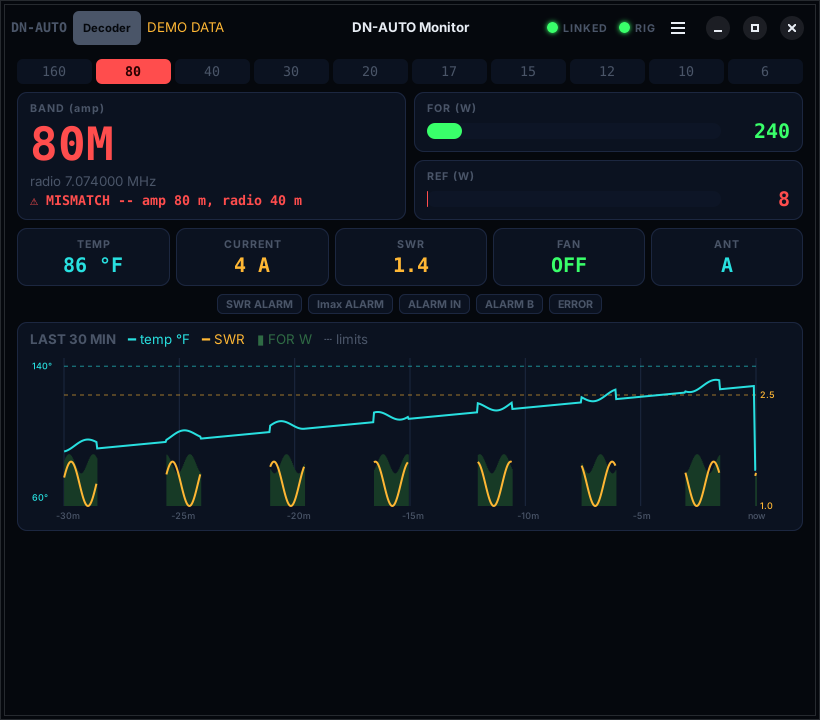
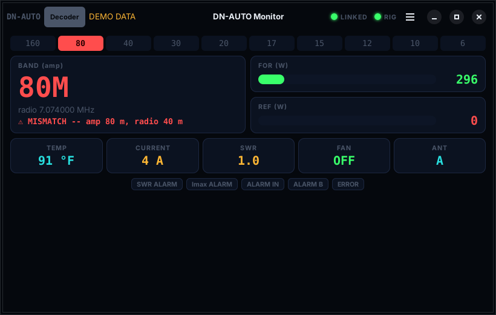

# DN-AUTO Monitor for Linux

A Linux replacement for **AmpMonitor**, the Windows-only program for the DN-AUTO CPU (the band-decoder / protection controller used in dn-radio.com / UT2FW amplifiers). It reads the controller's RS-232 monitor port and shows band, forward and reflected power, SWR, temperature, current, fan, antenna and alarms. It also does a few things AmpMonitor doesn't.



*(Screenshots use the built-in demo data.)*

## What it does

- Live band, FOR/REF power, SWR, temperature (°F), current, fan and antenna A/B, plus the controller's own alarm flags (SWR, Imax, ALARM IN, ALARM B, error).
- **Band mismatch alarm**: give it your radio's `rigctld` and it checks the amp's band against the radio's. If they disagree for more than a couple of seconds, you hear about it before you transmit into the wrong filter.
- **Your own alarm limits** for temperature and SWR, with desktop notifications, set from menu › **Edit alarm limits…**
- A **30-minute history** of temperature, SWR and power.
- Reconnects by itself if the serial adapter is unplugged. Closing the window keeps it watching in the background.
- Writes a small status file that [Shack Services](https://github.com/Saltyhaus/shack-services) shows as its AMP row.



## How it knows the protocol

The vendor doesn't publish the serial protocol. It was worked out from how AmpMonitor reads the port, then checked against AmpMonitor itself and the real amplifier. The DN-AUTO streams 16 channels, each sent as 3 bytes, with no polling needed. The full write-up is in **[docs/NOTES.md](docs/NOTES.md)**: wire format, what each channel means and how sure that is, wiring the X7 port, troubleshooting and calibration. No AmpMonitor code is included here; this is a from-scratch implementation.

## What you need

- A serial connection to the DN-AUTO CPU's **X7** monitor port: 9600 baud 8N1. Pin 1 → PC RxD, pin 2 → PC TxD, pin 3 → GND. Any USB-RS232 adapter works.
- Python 3 with pyserial. GTK 4 and libadwaita 1.4+ for this window; with older ones it opens a Tk window instead.
- Optional: `rigctld` for your radio, for the mismatch check and the radio frequency display.

## Install

```
git clone https://github.com/Saltyhaus/dnauto-linux-monitor.git
cd dnauto-linux-monitor
./install-gtk.sh
```

That installs the packages (GTK, pyserial), runs the tests, and adds **DN-AUTO Monitor** to the app grid.

No hardware handy? Try it with demo data:

```
python3 dnauto_gtk.py --demo
```

## Set it up

Tell the launcher where the adapter is and which `rigctld` to check against, in `~/.config/dnauto-monitor/launcher.env`:

```
DNAUTO_PORT=/dev/serial/by-id/usb-YOUR_ADAPTER-if00-port0
DNAUTO_RIGCTLD=127.0.0.1:4532     # empty for no radio check
```

Use the `/dev/serial/by-id/...` path (`ls -l /dev/serial/by-id/`), which stays the same across reboots, unlike `/dev/ttyUSB0`. Or make a short `/dev/dnauto` name with a udev rule, as described in [docs/NOTES.md](docs/NOTES.md#making-the-port-name-survive-reboots). `/dev/dnauto` is the default.

Alarm limits live in `~/.config/dnauto-monitor/limits.ini` (created on first start). Changes are picked up within a few seconds.

## Other tools in here

| | |
|---|---|
| `dnauto_monitor.py PORT` | text dashboard in a terminal; `--raw` for every channel update |
| `dnauto_rawdump.py PORT` | raw hex of whatever arrives, for a port that seems dead |
| `dnauto_diagnose.py PORT` | catches erratic power/SWR readings and the bytes around them |
| `calibrate_band.py` | maps the band channel against known band codes |

## Tests

```
python3 test_dnauto_protocol.py
python3 test_rigctl_client.py
python3 -m unittest test_alerts
```

## Related

Driving the amp's band switching from a KX3 (or any radio without Yaesu band data): [kx3-band-bridge](https://github.com/Saltyhaus/kx3-band-bridge).

## License

GPL-3.0-or-later. 73 de AG7JC.
